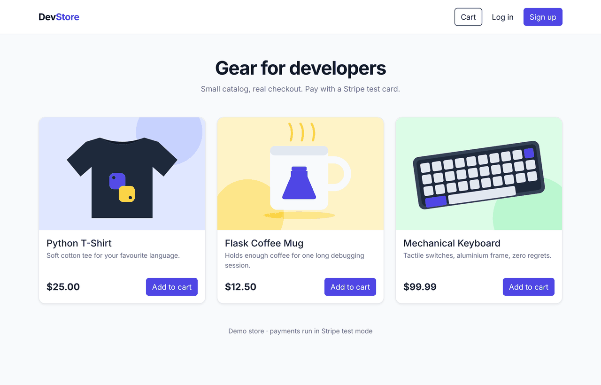
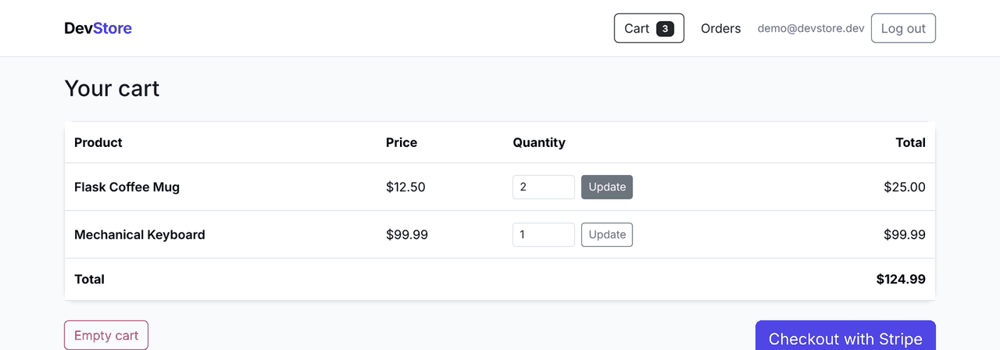
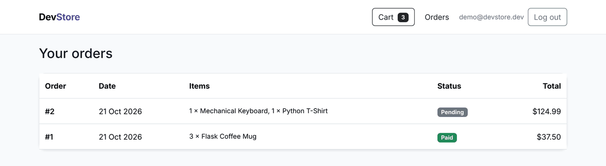
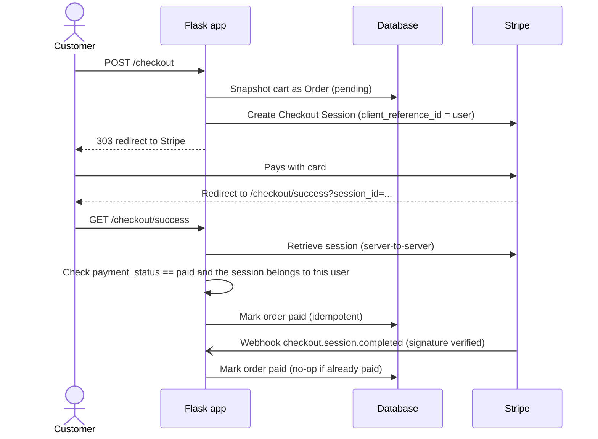

# DevStore: Flask e-commerce with verified Stripe Checkout

[](https://github.com/Khizar226/flask-ecommerce-store/actions/workflows/ci.yml)


A small but complete online store built with Flask. It handles accounts, a quantity-aware cart, order history, and payments through Stripe Checkout. Orders are only marked as paid after the server confirms the payment with Stripe.



| Cart | Order history |
|---|---|
|  |  |

## Features

- **Accounts:** sign-up and login with salted password hashes (Werkzeug), normalized emails, and protection against open redirects after login.
- **Cart:** stored in the session as product IDs and quantities only. Prices always come from the database, so a client can't change what it pays.
- **Checkout:** Stripe-hosted payment page, with line items and quantities built on the server.
- **Orders:** price and name are snapshotted at checkout, and each order moves from `pending` to `paid` exactly once.
- **Security:** CSRF protection on every form, every state change uses POST, secrets come from the environment, and cookies are HttpOnly with SameSite.
- **Quality:** 19 pytest tests (Stripe is mocked), ruff lint and format checks, and CI on Python 3.11–3.13.

## How checkout works



Visiting the success URL proves nothing on its own. The app checks the session with Stripe's API before marking anything as paid. The webhook is a backup, so the order is still fulfilled if the customer closes the tab before the redirect.

## Project structure

```
app.py                 Entry point (loads .env, creates the app)
shop/
  __init__.py          App factory, blueprints, `seed` CLI command
  config.py            Settings read from environment variables
  extensions.py        SQLAlchemy, Flask-Login, CSRF
  models.py            User, Product, Order, OrderItem
  cart.py              Session cart helpers
  auth.py              Register / login / logout
  store.py             Catalog, cart and order history routes
  checkout.py          Stripe Checkout, success verification, webhook
templates/             Jinja2 + Bootstrap 5 views
static/img/            Product artwork
tests/                 pytest suite
```

## Run locally

```bash
git clone https://github.com/Khizar226/flask-ecommerce-store.git
cd flask-ecommerce-store
python -m venv .venv && source .venv/bin/activate   # Windows: .venv\Scripts\activate
pip install -r requirements.txt

cp .env.example .env
# Set SECRET_KEY (python -c "import secrets; print(secrets.token_hex(32))")
# and STRIPE_SECRET_KEY (a test-mode key from dashboard.stripe.com)

flask --app app seed      # add sample products
flask --app app run       # http://127.0.0.1:5000
```

Pay with Stripe's test card `4242 4242 4242 4242`, using any future expiry date and any CVC.

**Webhooks (optional):** run `stripe listen --forward-to localhost:5000/stripe/webhook` and put the `whsec_...` value it prints into `STRIPE_WEBHOOK_SECRET`.

## Configuration

| Variable | Required | Purpose |
|---|---|---|
| `SECRET_KEY` | yes | Signs session cookies. The app refuses to start without it. |
| `STRIPE_SECRET_KEY` | for checkout | Stripe API key. Use a test-mode key while developing. |
| `STRIPE_WEBHOOK_SECRET` | no | Turns on the signature-verified webhook endpoint. |
| `BASE_URL` | no | Public URL used in Stripe redirect links. |
| `DATABASE_URL` | no | SQLAlchemy URL. Defaults to SQLite. |
| `SESSION_COOKIE_SECURE` | prod | Set to `1` when serving over HTTPS. |

## Tests

```bash
pip install -r requirements-dev.txt
pytest -q
ruff check . && ruff format --check .
```

## Roadmap

- Database migrations with Flask-Migrate (tables are currently created on startup)
- Admin panel for managing products and stock
- Stock reservation while checkout is open
- Rate limiting on login
- Dockerfile and a hosted demo

## License

MIT © Khizar Hayat
